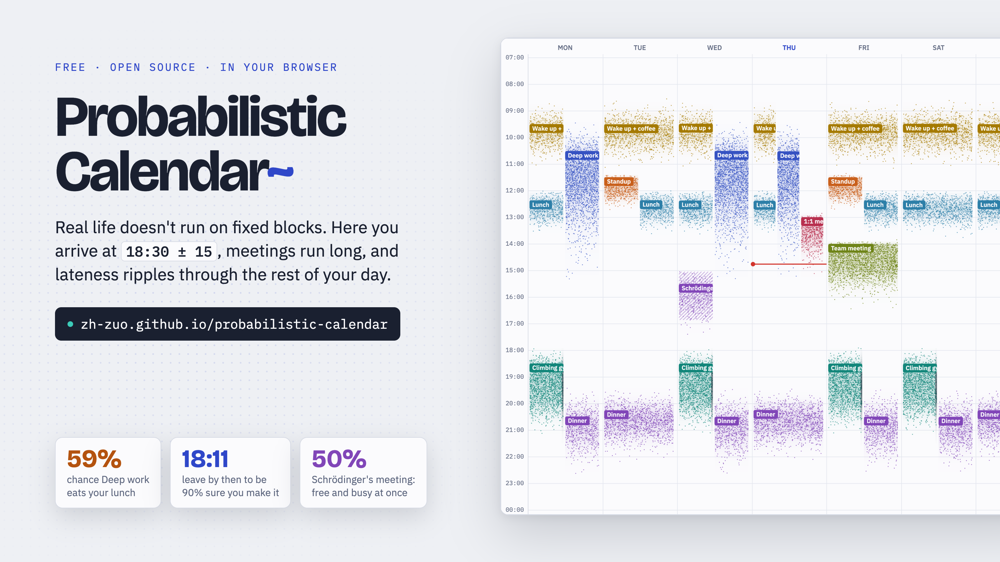
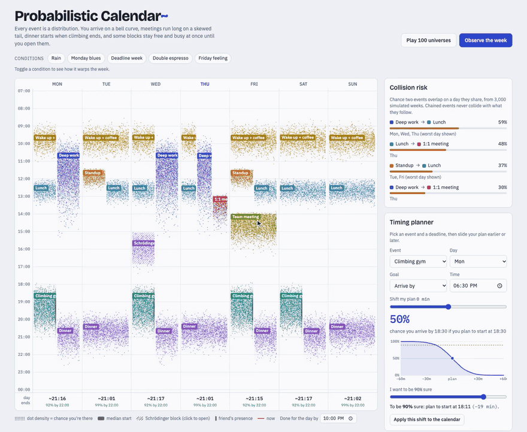
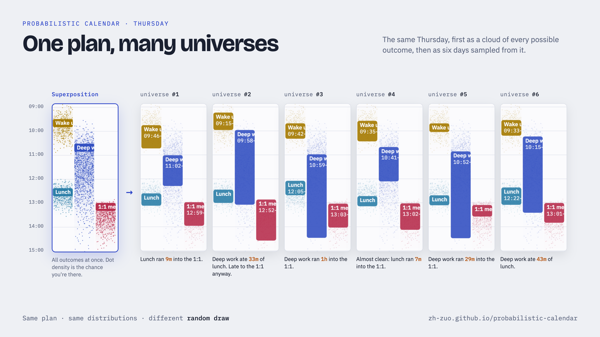

# Probabilistic Calendar

<p align="center">
  <a href="https://zh-zuo.github.io/probabilistic-calendar/"></a>
</p>

<p align="center">
  <a href="https://zh-zuo.github.io/probabilistic-calendar/"></a>
</p>

A week calendar where every event is a probability distribution instead of a fixed block. It runs entirely in your browser: no sign-up, and your data never leaves your device.

## Demo

<p align="center">
  <a href="media/demo.mp4"></a>
</p>
<p align="center"><sub>Hover for live odds · toggle conditions · open a Schrödinger block · slide the timing planner · observe a universe · play 100 universes. <a href="media/demo.mp4">Full-quality MP4</a>.</sub></p>

<p align="center"></p>

## Features

The [live app](https://zh-zuo.github.io/probabilistic-calendar/) opens on a demo week. Earlier versions are kept at [/v1/](https://zh-zuo.github.io/probabilistic-calendar/v1/) and [/v2/](https://zh-zuo.github.io/probabilistic-calendar/v2/).

- **Real dates**: week navigation, weekly events, one-off events on a date, and "skip this date".
- **Daily log**: tap *Arrived now* and *Done now* (or type the times). The rest of the day re-forecasts from what you logged, and logged events show as solid blocks: the future is a cloud, the past is what happened.
- **Learning**: each event fits its arrival time and duration from your logs, starting from your plan and moving toward your real timing as logs accumulate ("you planned 18:30 ± 15; you arrive 18:44 ± 15").
- **Arrival shapes**: for each event, pick Gaussian (as likely early as late), Skewed (usually near the typical time, with a long tail toward early or late, set by a slider), Uniform (any time in a window), Exact, or After another event (with a skewable gap). The editor previews the shape as you change it.
- **Distributions**: arrivals as above; durations right-skewed (meetings run long), symmetric, or fixed. Each event is a cloud of dots whose density is the chance you're there (2,500 simulated weeks).
- **Chained events**: "Dinner starts 20 ± 10 min after Climbing ends", so lateness propagates. The day-ends strip shows the chance each day is done by your bedtime.
- **Timing planner**: slide your plan earlier or later and see the chance you arrive or finish by a deadline; or ask "to be 90% sure, when do I start?"
- **Bets**: bet on your own week. Bets settle themselves when you log the event, and the page keeps a Brier score for you and for the model.
- **Schrödinger blocks**: events with less than 100% chance of happening are free and busy at once until you click to open the box.
- **Invites**: copy a link that carries your arrival distribution; whoever opens it gets the event plus meet-up odds.
- **Conditions**: Rain, Monday blues, Deadline week, Double espresso, Friday feeling warp the distributions.
- **Observe / Play 100 universes**: sample concrete weeks and tally what collided.
- **Import and export**: import an `.ics` file from Google Calendar, Apple Calendar or Outlook; export the next 4 weeks as `.ics` with each event blocked from its median start to its 90% finish time.

## Make it yours

Your copy of the repo is your calendar. There are no accounts: whoever can push to the repo owns the calendar.

1. Click **Use this template** (or fork) to make your own repo.
2. In your repo, open **Settings → Pages**, set the source to the `main` branch, and save. Your calendar appears at `https://<you>.github.io/<repo>/`.
3. Put your events in `calendar.json`. The easy way: edit events in the app, click **Copy JSON** in *Your calendar file*, then **Edit calendar.json on GitHub**, paste, and commit. You can also start from an `.ics` export of your current calendar.

The app loads `calendar.json` on every visit. Edits you make in the browser stay in that browser until you put them back into `calendar.json`.

### What is public and what stays private

| Where | What | Who can see it |
|---|---|---|
| `calendar.json` in your repo | Your events and their distributions | Anyone, if the repo is public |
| Your browser | Logs, bets, events marked **Private**, conditions | Only you, on that browser |
| Invite links | One event's name and timing | Anyone you send the link to (links do not expire) |

A GitHub Pages site is public even when its repo is private (access-controlled Pages needs GitHub Enterprise), so mark anything personal as **Private** in the event editor; private events never go into `calendar.json`. Use **Back up everything** to save your logs and private events to a file, and **Restore a backup** to move them to another browser.

## Use it locally

No server or GitHub needed:

- **From the app**: click **Download the app** in *Your calendar file*. You get one `probabilistic-calendar.html` with your calendar built in. Double-click it to open it in your browser; it works offline.
- **From the repo**: download [`index.html`](index.html) (or the whole repo as a ZIP from **Code → Download ZIP**) and open it. Opened directly, it shows the demo week, because browsers do not let a local file read `calendar.json`. To load your `calendar.json` locally, run a small web server in the folder and open the address it prints:

  ```sh
  python3 -m http.server 8000
  # then open http://localhost:8000
  ```

Logs and bets are saved in the browser that made them. Fonts load from Google Fonts when online and fall back to system fonts offline.

Single static `index.html`, no build step.

## License

MIT. See [LICENSE](LICENSE).
